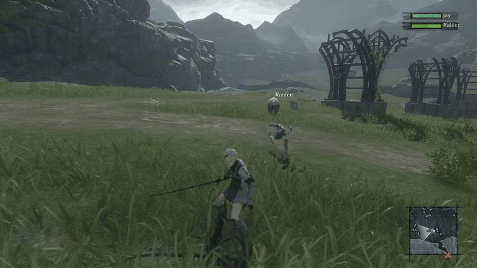

<p align="center">
  
  <h1 align="center">Replicant Co-op</h1>
  <h6 align="center">Online co-op for NieR Replicant ver.1.22474487139 on PC.</h6>
</p>

<p align="center">
  
</p>

---

## About
Both players run their own copy of the game and see each other in the same world. Connections are peer-to-peer.
Works on Windows, and on Linux through Proton.

This is a fan project. It is not affiliated with or endorsed by Square Enix.

## Status
Early. Played by hand with two copies of the game on one PC, and between a Windows PC and a Linux PC (through Proton).

What does not work yet:
- Rides, mini-games, rule rooms and fixed-camera rooms run separately for each player.
- Player 2 as a companion character.

## Getting started
1. Download the launcher from the GitHub Releases page and run it.
2. Settings: press Find to locate your game, then Install mod.
3. New game: type your name and pick your character. One player presses Host a lobby and sends the ticket, the other
   pastes it and presses Join a lobby. When both are ready, the host presses Start.
4. Continue: each player picks a co-op save slot, then host and join the same way.
5. Insert opens the in-game menu.

When something goes wrong, the footer has Copy log and Export logs, to send with a bug report.

## Building
You need the Rust toolchain pinned in `rust-toolchain.toml`. The hook is a Windows DLL (`x86_64-pc-windows-msvc`);
on Linux, build it with `cargo xwin`. The launcher builds on both Windows and Linux.

## Contributing
Before you open a pull request, run these from the repository root:

```
cargo fmt --all -- --check
cargo clippy --workspace --all-targets -- -D warnings
cargo test --workspace
```
